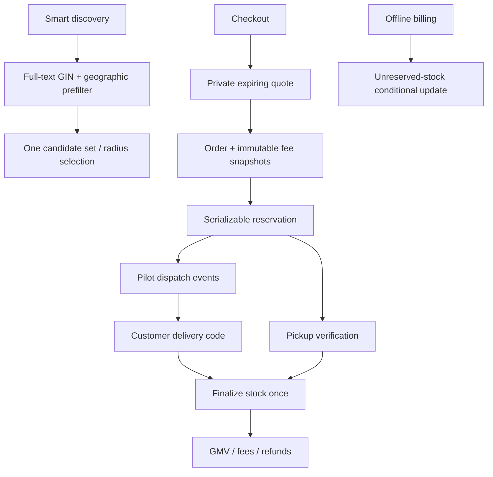
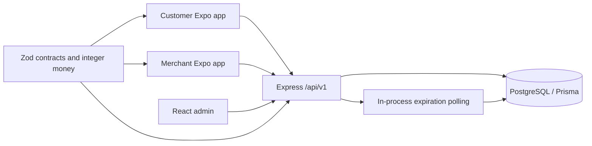

# Architecture

V2 adds shared yellow design tokens, a typed discovery client, and backend discovery/offline-sales/logistics/payment boundaries. Existing authentication and pickup routes remain intact. See `v2-progress.md` for implementation versus disabled modules.

Apps use TanStack Query for cached reads and polling. Zustand stores the native session; SecureStore persists native refresh/access credentials. The admin session stays in memory. Server-side roles are loaded from the user record on every authenticated request. Merchant ownership is verified through the shop relation.

Business transitions run in serializable transactions, lock the order row, and modify stock through conditional atomic updates. Serialization/uniqueness conflicts retry at most three times. Clients reuse an idempotency key for a failed checkout until successful; different payloads cannot reuse the same key.

One database-backed notification is created transactionally with each order state change. The in-process expiration worker polls every minute; on a sleeping/free-tier server expired orders are processed after wake-up. No Redis is required. Push/email/storage/provider adapters remain deployment work, documented in README.
