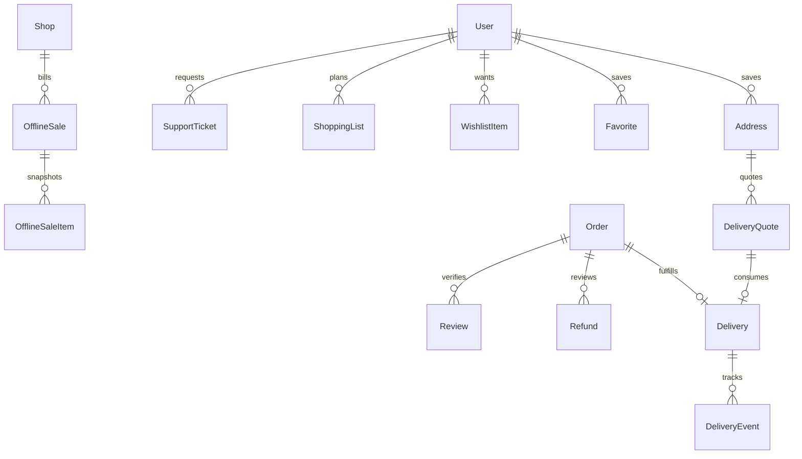
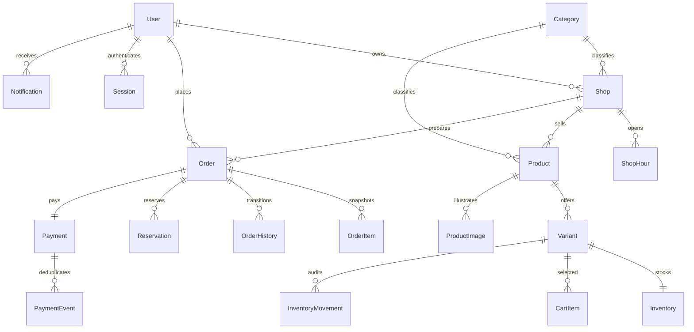

# Database design

V2 migrations add addresses, delivery quotes/bookings/events, offline sale snapshots/items, commission rules, refunds, favorites, wishlist, shopping lists, reviews and support tickets without replacing original tables. Historical merchandise/payable amounts are backfilled from captured totals. Financial/fulfillment snapshots have an immutability trigger. Product search uses a generated tsvector/GIN index; approved-shop coordinates use a partial geographic index. Private row backups are only under ignored `.local/backups`.

The Prisma source is `services/api/prisma/schema.prisma`. Versioned SQL migrations live beside it in `services/api/prisma/migrations`, where Prisma discovers them. `database/seeds` supplies local-only demo data.

Prices are integer paise, quantities integer thousandths of units. Integer calculations use BigInt intermediates and round half-up at the line level. Order lines snapshot name, description, unit, price and quantity. Inventory enforces `0 <= reserved <= onHand`. A unique `(orderId,variantId)` reservation prevents duplicates. A unique `(customerId,idempotencyKey)` prevents duplicate checkout. Payment events have unique provider IDs.

Roles are constrained strings rather than a separate roles table. Profile fields live on User and Shop; pickup nonce/hash/attempts live on Order. Cart rows are keyed by user/variant. Public product serialization hides raw stock unless permitted; precise customer coordinates are used only in the discovery request and not persisted or shared with merchants.

Product archive uses `active=false`. Shop approval and suspension control public visibility. Inventory history is append-only at the database level. Production database roles should also deny DELETE/UPDATE on audit/history tables. No image binaries or payment credentials are stored here.
