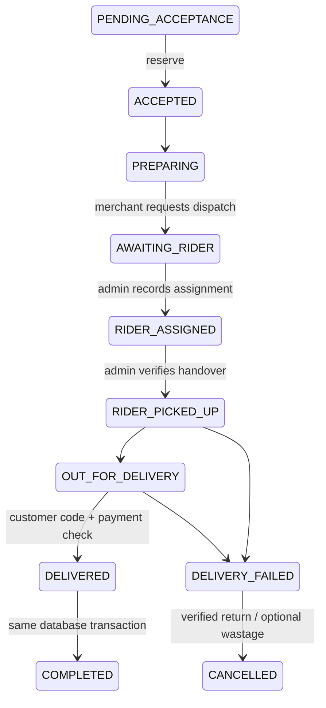

# Delivery pilot lifecycle

Quotes bind customer, shop, private address snapshot, provider, fee and ten-minute expiry. A quote can be consumed once. A retry of the same order key returns the original order even when the quote is consumed. New orders cannot reuse it. Payment amounts include the exact quoted charge and are recomputed by the server.

The `LogisticsProvider` interface includes serviceability, quote, booking, status, cancellation and webhook verification. The pilot creates deterministic booking references and persists event state in PostgreSQL. Public unsigned callbacks are rejected. Only authenticated administrators can record pilot events. A real Borzo/Shiprocket adapter is not implemented; no external API endpoints are invented.

Manual production delivery requires `ENABLE_MANUAL_DELIVERY=true`; merchants must independently enable delivery and COD. Development uses provider `MOCK` and returns an explicit simulation notice. No automated rider or delivery time is promised.

During transit, onHand is a ledger balance including reserved goods outside the shop; reserved stock remains unavailable for other sales. Successful delivery finalizes onHand/reserved once. Failure does not return goods to available stock. Admin must confirm physical return; damaged returns reduce onHand as `RETURN_WASTAGE`. Refund processing remains independent from physical returns.
