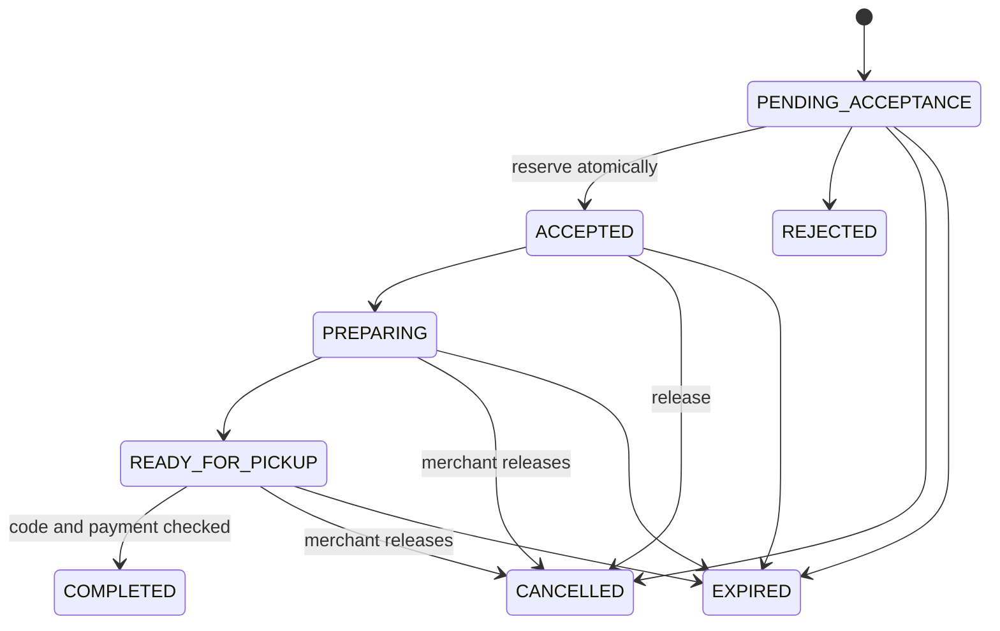

# Order lifecycle

Pending requests expire after 30 minutes; accepted orders have a 24-hour pickup deadline. Acceptance reserves stock. A customer may cancel pending/accepted orders; after preparation begins the merchant must handle cancellation. Completion requires READY_FOR_PICKUP, merchant ownership, a valid code and confirmed collection of payment (or a paid simulation).

Six-digit codes are derived with a server HMAC secret and a per-order random nonce. Only a SHA-256 hash and nonce are stored. Only the owning customer receives the derived code when ready. Five failed attempts lock verification; no self-service unlock is implemented. Incorrect attempts commit before returning an error. The secret must be preserved across deployment and rotated only with a plan for active orders.

Repeated acceptance and completion are idempotent after ownership checks. Row locks serialize cancel/accept/complete races. Terminal transitions release each reservation once. Simulated paid cancellations/expirations become SIMULATED_REFUNDED. Real payments are disabled; a real provider must implement verified events, reconciliation and refund-required processing before enabling collection.
